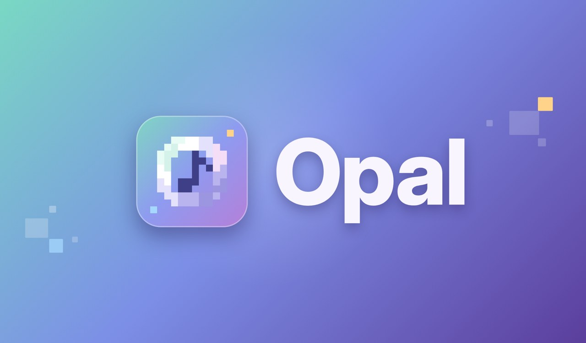
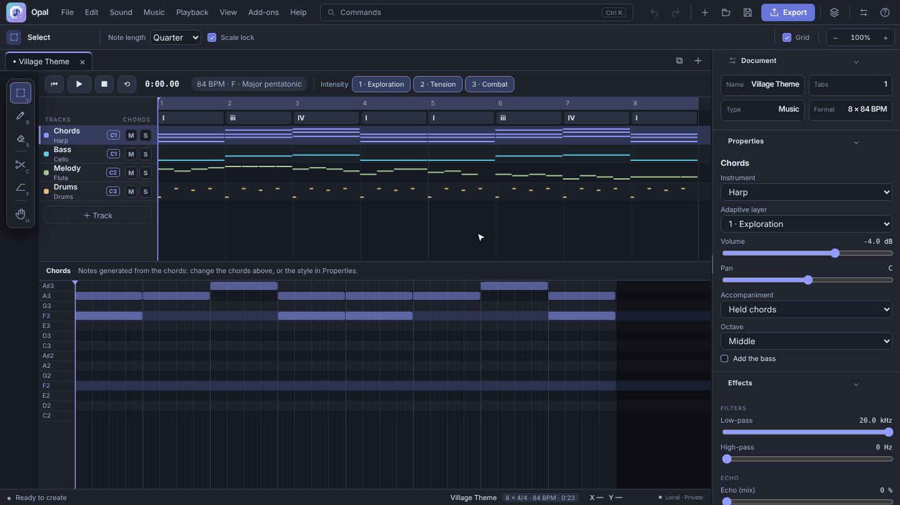
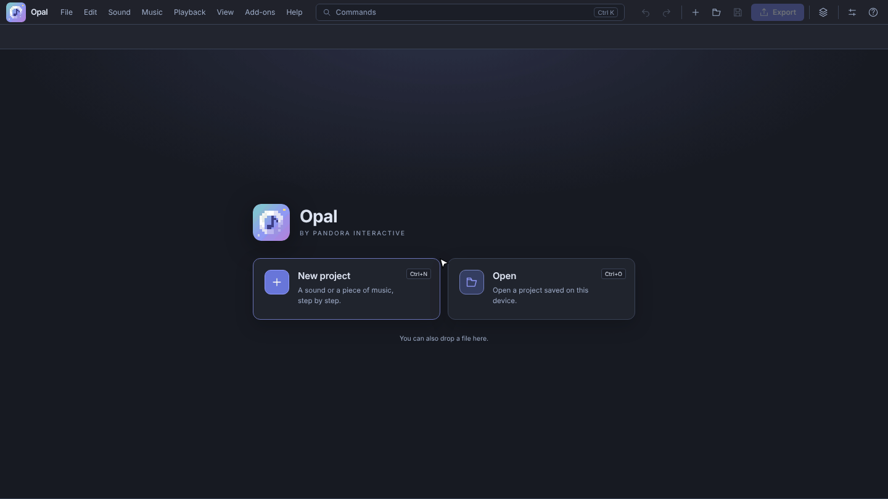
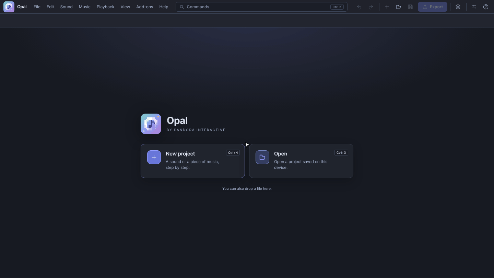
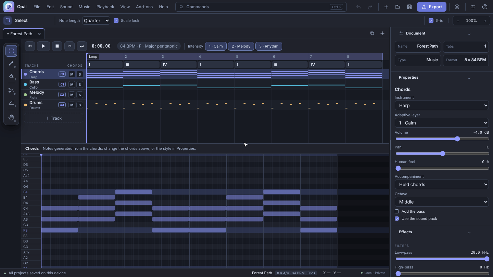
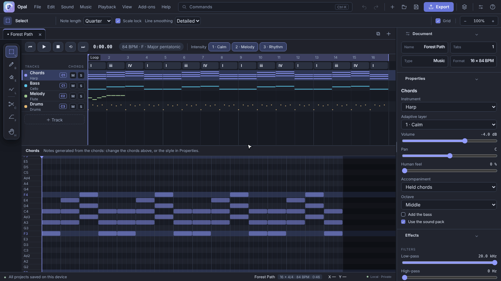
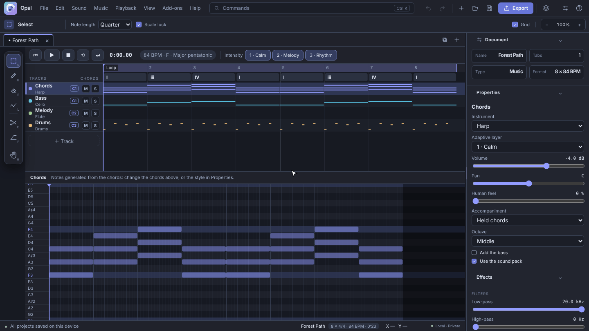
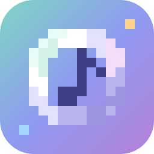

<p align="center">
  
</p>

<p align="center">
  
  
  
  
</p>

<p align="center">
  <strong>Sound effects and adaptive music for games, even if you don't play an instrument.</strong><br>
  Sound design · scale-locked piano roll · adaptive layers · offline-first
</p>

<p align="center">
  <a href="https://github.com/itsnelys/Opal-Releases/releases/latest"><b>⬇ Download the latest version</b></a> ·
  <a href="https://github.com/itsnelys/Opal-Releases/releases">All releases</a> ·
  <a href="#-whats-inside">Features</a> ·
  <a href="#-the-pandora-suite">The suite</a>
</p>

---

Opal is the audio studio of the Pandora Interactive suite. It makes the sound effects, ambiences and music of Grimward: Pixora draws the textures, Jade builds the models, Opal brings the sound. In its scale-locked piano roll you cannot place a wrong note, the accompaniment follows the chords, drums come as ready-made rhythms and a melody assistant suggests ideas you can keep or reject. No account and no browser: your projects stay on your computer.

This repository hosts the **official Windows builds and release notes**. The application source code is private.

<p align="center">
  
</p>

## ⬇ Download

| File | What it is |
| --- | --- |
| [**Opal-Setup.exe**](https://github.com/itsnelys/Opal-Releases/releases/latest/download/Opal-Setup.exe) | Installer, with Start menu shortcuts and `.opal` file association. Recommended. |
| [**Opal-Portable.exe**](https://github.com/itsnelys/Opal-Releases/releases/latest/download/Opal-Portable.exe) | Runs without installation, from any folder or USB drive. |
| `Opal.notpatch` · `Opal.updater` | Release notes and update descriptor, read by Opal's built-in update manager. |
| `SHA256SUMS.txt` | Checksums to verify every file you download. |

**Requirements:** Windows 10 or 11, 64-bit. Nothing else to install. On first launch Opal offers the optional **sound pack** (36 MB of recorded instruments); you can also install it later from **File → Sound pack…**.

Each release also carries versioned copies (`Opal-Setup-1.0.0.exe`, `Opal-Portable-1.0.0.exe`). The download links above always point to the newest published version.

## 🎬 See it in action

<table>
<tr>
<td width="50%"><br><sub><b>New music</b> · <i>New project → A piece of music → Combat</i>: a 16-bar loop with intro and ending, then the three adaptive layers <i>Tension</i>, <i>Combat</i> and <i>Climax</i>.</sub></td>
<td width="50%"><br><sub><b>Intro, loop and ending</b> · the tavern example loops, then <i>Play the ending</i> waits for the next bar and lets the 4-bar ending ring out.</sub></td>
</tr>
<tr>
<td><br><sub><b>Melody assistant</b> · three melodies that follow the chords: listen, keep one, play it with the band.</sub></td>
<td><br><sub><b>Sound</b> · import a gong, normalize it, add a cave reverb, name the event <code>temple.gong</code> and generate 5 pitch variations.</sub></td>
</tr>
<tr>
<td><br><sub><b>Editing</b> · box-select notes, raise them one scale step, double their length, repeat bars and duplicate a named section.</sub></td>
<td><br><sub><b>Melody line (L)</b> · draw a curve and the notes follow it, always in the scale, on chord notes on strong beats.</sub></td>
</tr>
</table>

## ✨ What's inside

<table>
<tr>
<td width="50%" valign="top">

### 🎼 Music
- Start from the moment of the game: exploration, tavern, mystery, dungeon, combat, boss, victory, 8-bit
- Chords, melody, bass and drums written for you
- **Scale-locked piano roll**: no wrong notes
- **Melody assistant**, *Vary the melody* and the **Melody line** tool
- Human feel: tiny timing and velocity changes, rolled chords
- **Virtual piano** on the computer keyboard, live or step recording
- Sections (A, B, bridge), repeat bars, key and tempo changes

</td>
<td width="50%" valign="top">

### 🔊 Sound design
- Import WAV, OGG, MP3 or FLAC, record from the microphone, or generate effects
- Automatic clean-up: silences trimmed, level normalized, short fades
- Layers with move, trim, split, fades, pitch and speed
- Filters, echo, five reverbs, reverse, normalize
- **Add a low / high layer** for more impact or sparkle
- Up to 16 **variations** per sound, compared side by side

</td>
</tr>
<tr>
<td valign="top">

### 🎮 Made for the game
- **Adaptive music**: up to 6 layers the game adds as the action builds
- **Intro, loop and ending**, with perfect loops and the reverb tail folded back
- Game **events** with priority, cooldown and 3D settings (1 block = 1 m)
- A shared event list keeps names consistent

</td>
<td valign="top">

### 🎻 Instruments
- 48 synthesized instruments, no download needed
- Optional **sound pack**: 27 recorded instruments and 16 drum sounds (463 CC0 samples from VCSL and VSCO 2 CE)
- Free sound libraries through the **Freesound** add-on, with author and licence kept for the credits

</td>
</tr>
</table>

**Three example pieces** are included in **File → Example music…**: a tavern tune in G Mixolydian, a misty exploration theme in D Dorian and a forgotten crypt in E Phrygian.

**And everything you expect from the suite:** projects in tabs, a welcome screen with recent projects, crash recovery, a 5-step guide on each new project, six themes, six languages (English, French, Spanish, German, Portuguese, Italian), a command palette (Ctrl+K), Discord status, automatic updates and isolated add-ons.

## 📁 File formats

| File | Content |
| --- | --- |
| `.opal` | Project: one sound or one piece of music, fully editable |
| `.sopal` | Sound for the game, with its event, variations and 3D settings (sealed) |
| `.mopal` | Music for the game: one stem per adaptive layer, loop points and endings (sealed) |
| `.wav` · `.ogg` | Open exports (WAV 48 kHz / 24-bit, Ogg Opus), layers can be exported separately |
| `.opalpack` | Optional sound pack |
| `.opaladdon` | Add-on package |

Imports: WAV, OGG, MP3, FLAC, WebM and MIDI.

## 🔄 Updates

Opal checks this repository at start-up and offers new stable versions with their release notes. Choose **Yes, update** to download, verify (size and SHA-256) and install it, or **Not now** to be reminded the next day. You can always check by hand from the **Updates** menu.

## 🛡 Verify your download

Open PowerShell in your download folder and compare the result with `SHA256SUMS.txt`:

```powershell
Get-FileHash .\Opal-Setup.exe -Algorithm SHA256
```

Opal is not signed with a commercial certificate yet, so Windows SmartScreen may show a warning the first time. Choose **More info → Run anyway** after checking the hash.

## 🧩 The Pandora suite

<table>
<tr>
<td align="center" width="33%"><a href="https://github.com/itsnelys/Pixora-Releases"><br><b>Pixora</b></a><br><sub>Pixel art, textures and animated sprites</sub></td>
<td align="center" width="33%"><a href="https://github.com/itsnelys/Jade-Releases"><br><b>Jade</b></a><br><sub>Cube models, rigs and animations</sub></td>
<td align="center" width="33%"><a href="https://github.com/itsnelys/Opal-Releases"><br><b>Opal</b></a><br><sub>Sound effects and adaptive music</sub></td>
</tr>
</table>

## 💬 Support

Questions or a problem? Send a problem report from inside Opal, or write to **contact@pandora-interactive.fr**.

---

<p align="center"><sub><b>Opal</b> by Pandora Interactive · © 2026 Pandora Interactive. All rights reserved.<br>Free downloads do not grant an open-source licence. The application source code is private.<br>Sound pack samples: VCSL and VSCO 2 Community Edition, CC0.</sub></p>
